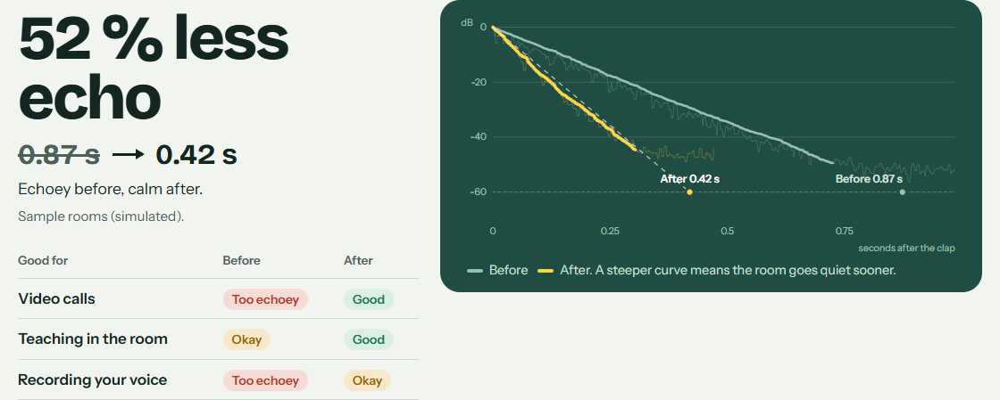
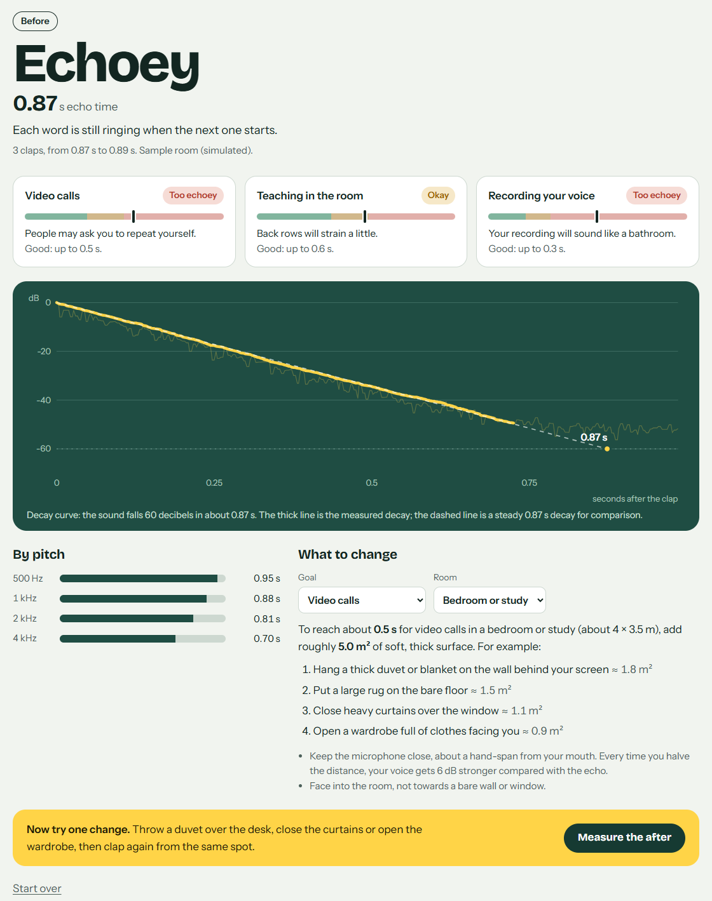
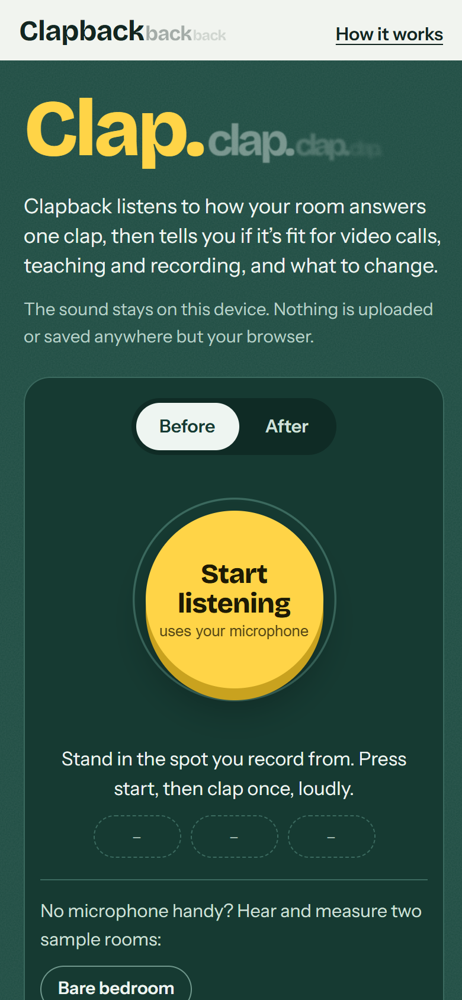
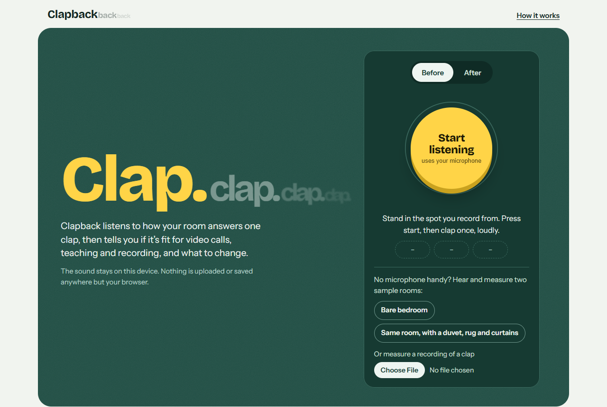

# Clapback

**Clap once. See how echoey your room is, what that means for calls, teaching and recording, and what to change.**

Clapback is a free web app that measures a room's echo time (RT60) from a single hand clap, using the microphone of a phone or laptop. It draws the decay curve, rates the room for video calls, teaching and voice recording, suggests household fixes sized with Sabine's formula, and shows a before/after comparison when you change something.

**Try it: https://clapback.pages.dev** · **Demo video (2 min): https://youtu.be/w18_SYeGtQc** (no install, no account; press "Bare bedroom", then "Same room, with a duvet, rug and curtains" if you have no microphone handy).



## Why

Students now record presentations, teach online and take classes from bedrooms, kitchens and empty rented rooms. A room that rings makes speech blur: people ask you to repeat yourself on calls, and recordings sound like they were made in a bathroom. The usual fix is soft stuff (a duvet, a rug, curtains), but nobody knows whether their room is the problem, or whether the duvet actually helped. Pro tools such as Room EQ Wizard need a measurement microphone and a speaker; the clap apps that exist are mostly iPhone installs; online "RT60 calculators" only guess from room size. Clapback measures your actual room in the browser you already have.

## How to use it

1. Open https://clapback.pages.dev on a phone or laptop and stand where you usually record or take calls.
2. Press **Start listening** and allow the microphone.
3. Clap once, sharply, then stay quiet for three seconds. Clap three times in all; Clapback shows the middle value.
4. Read the verdict, the decay curve and the fixes. Pick your goal and room size to resize the suggestions.
5. Change one thing (throw a duvet over the desk, close the curtains), press **Measure the after**, and clap again from the same spot.

| The room's verdict | On a phone |
| --- | --- |
|  |  |



## How it works

Everything runs in the browser; no sound leaves the device.

- **Capture.** `getUserMedia` with echo cancellation, noise suppression and automatic gain control turned **off** (all three reshape the decay being measured). An AudioWorklet streams raw samples; a ring buffer keeps the last 0.6 s so the quiet moment before the clap is available as a noise reference. A clap is a block more than about 28 dB above the running noise level; Clapback then records three more seconds.
- **Bands.** The recording is split into zero-phase octave bands at 500 Hz, 1 kHz, 2 kHz and 4 kHz (FFT, Butterworth-shaped magnitude, about −26 dB at neighbouring band centres).
- **Decay.** For each band: the smoothed energy envelope is fitted to find where the decay meets the noise floor (the crosspoint, after Lundeby et al., 1995); the noise energy is subtracted; the energy is integrated backwards in time up to the crosspoint (Schroeder, 1965), with the energy of the fitted tail beyond it added back.
- **Echo time.** A straight line is fitted to the decay curve between −5 and −35 dB (T30), or −25 dB (T20) or −15 dB (T10) when the clap is not loud enough above the noise for the wider range, and extrapolated to 60 dB. The headline number is the mean of the 500 Hz, 1 kHz and 2 kHz bands, the speech range used by classroom standards.
- **Advice.** Grades use rules of thumb: calls good up to 0.5 s, teaching up to 0.6 s (ANSI/ASA S12.60 for classrooms under 283 m³), voice recording up to 0.3 s. Fix sizes come from Sabine's formula, ΔA = 0.161 · V · (1/T_target − 1/T_now), with typical absorption areas for household items. When low frequencies ring much longer than high ones, Clapback recommends thick soft things over thin cloth.

Source: [`src/dsp/analyze.ts`](src/dsp/analyze.ts) (estimator), [`src/audio/capture.ts`](src/audio/capture.ts) (microphone and clap detection), [`src/verdict.ts`](src/verdict.ts) (grades and fixes).

## How accurate is it?

Tested on synthetic claps with a known echo time: a 2 ms noise burst convolved with a diffuse-field room (Gaussian noise under an exponential decay that falls 60 dB in exactly RT60 seconds), plus pink background noise. 10 random rooms per cell, RT60 from 0.2 to 2.0 s. Full table: [docs/ACCURACY.md](docs/ACCURACY.md) (regenerate with `npm run accuracy`).

| Clap level above room noise | Mean error | 90 % of readings within | Worst case | Textbook shortcut (no noise handling), mean error |
| --- | --- | --- | --- | --- |
| 55 dB (quiet room, loud clap) | 1.7 % | 3.8 % | 8.9 % | 1.1 % |
| 45 dB | 2.9 % | 5.9 % | 17.5 % | 11.5 % |
| 35 dB (noisy room or soft clap) | 4.0 % | 8.5 % | 21.2 % | 1485 % |

The "textbook shortcut" integrates to the end of the recording without handling noise. It is fine in a silent lab and fails badly in an ordinary bedroom, which is why Clapback measures the noise and finds the crosspoint first. The worst cases are short echo times (0.2–0.3 s), where a decay only lasts a few tens of milliseconds.

The full browser path (microphone permission, AudioWorklet, clap detection, analysis) is tested in Microsoft Edge with a fake microphone that plays three claps: a bare room with a true echo time of 0.88 s read 0.89, 0.87 and 0.86 s; the treated room (true 0.41 s) read 0.41, 0.42 and 0.37 s ([`scripts/e2e-mic.mjs`](scripts/e2e-mic.mjs)).

## Limitations

- **Synthetic validation only.** The rooms above are ideal diffuse fields. Real rooms have early reflections, flutter echo between parallel walls and decays that bend, so expect roughly ±10–20 % in a real room. That is enough to tell dry from echoey and to see whether a change helped; it is not a certified ISO 3382 measurement.
- **The clap is the sound source.** A hand clap is loud mainly between about 1 and 4 kHz and is not the same every time, which is why Clapback asks for three claps and shows the spread. Bass bands (below 500 Hz) are not reported because a clap has little energy there.
- **Phone microphones.** Some phones apply processing that a web page cannot switch off. If readings look much shorter than the room sounds, try another browser or a laptop.
- **Advice is approximate.** The grade thresholds are rules of thumb for small rooms, and fix sizes use typical absorption values for household items, not lab data.
- **Background noise.** Fans, traffic or talking during the three seconds after the clap make the reading rough or stop it; Clapback says so instead of guessing.

## Run it locally

```bash
npm install
npm run dev        # http://localhost:5173
npm test           # unit tests: estimator and advice (30 tests)
npm run accuracy   # regenerates docs/ACCURACY.md
npm run build      # static site in dist/
```

Requires Node 20 or later. The microphone needs `localhost` or HTTPS. `npm run samples` regenerates the sample rooms in `public/samples/` and the fake-microphone fixtures in `test/fixtures/`.

Deploy anywhere static, for example Cloudflare Pages: `npx wrangler pages deploy dist --project-name clapback`.

## Credits

- Methods: M. R. Schroeder, "New method of measuring reverberation time" (JASA, 1965); A. Lundeby et al., "Uncertainties of measurements in room acoustics" (Acustica, 1995); ISO 3382-2; ANSI/ASA S12.60 classroom acoustics; W. C. Sabine's reverberation formula.
- Fonts: [Bricolage Grotesque](https://github.com/ateliertriay/bricolage) and [Instrument Sans](https://github.com/Instrument/instrument-sans), both SIL Open Font License, via Fontsource.
- Built with TypeScript, Vite and Vitest. Browser tests use Playwright with Microsoft Edge.
- The sample rooms are simulated; no recordings of real people or places are included.

## Licence

MIT. See [LICENSE](LICENSE).
